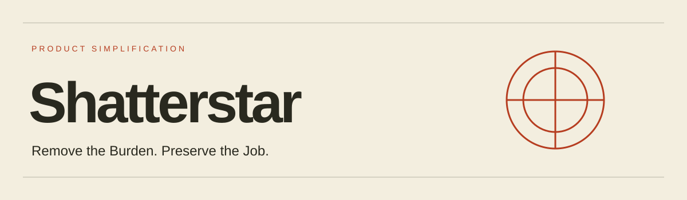

# Detailed Project Reference

[Return to the project overview](README.md). Setup, research and supporting detail are retained below.



# Shatterstar

Draft agent skill for evidence-backed product and interface simplification. For product managers, designers and engineers considering what to remove, combine, hide or defer while protecting important user jobs.

Use [shatterstar-product-simplification](skills/shatterstar-product-simplification/SKILL.md) with task descriptions, interface artifacts, dependencies and whatever research or usage evidence exists. Analytics are optional; unknowns stay explicit.

Example invocation: `$shatterstar-product-simplification Assess these overlapping output views. Rank subtraction proposals, preserve retrieval, comparison, export and recovery, and define reversible experiments with falsifiable criteria.`

Shatterstar evaluates the costs and task coverage of subtraction. It is not generic UI criticism, automatic redesign or authorization to delete implementation. Longshot tests rendered interfaces; Dazzler creates them. Those distinct tools may inform later work but are not dependencies.

Applications include navigation/dashboard consolidation, advanced controls, onboarding/forms, administrative workflows and feature retirement. [Research foundations and limits](skills/shatterstar-product-simplification/references/research.md) connect these uses to subtraction research, feature fatigue, information foraging, progressive disclosure, accessibility and operational retirement practice. Research informs the draft; it does not establish its efficacy.

See the [fictional worked example](skills/shatterstar-product-simplification/references/fictional-output-views.md). Validation covers structure and draft read-through only. No real application testing or human efficacy validation has been performed; predicted benefits remain hypotheses. No market-first or trademark-clearance claim is made.

## Installation

The package is `skills/shatterstar-product-simplification/`. Copy the whole folder, including `references/`; copying only `SKILL.md` breaks its supporting links. No application build or API key is required.

For Codex, install into the target project's `.agents/skills/` directory. From this checkout, run the following in PowerShell, replacing the target path:

```powershell
$targetProject = 'C:\path\to\your-project'
$skillParent = Join-Path $targetProject '.agents/skills'
$skillTarget = Join-Path $skillParent 'shatterstar-product-simplification'
if (Test-Path -LiteralPath $skillTarget) { throw 'Skill already exists; review it before updating.' }
New-Item -ItemType Directory -Path $skillParent -Force | Out-Null
Copy-Item -LiteralPath './skills/shatterstar-product-simplification' -Destination $skillParent -Recurse
```

Confirm the installed folder contains `SKILL.md` and all reference files. Open the target project in Codex and invoke `$shatterstar-product-simplification` with a task brief. See the [official skill documentation](https://learn.chatgpt.com/docs/build-skills) for discovery and other installation scopes. For another agent, use its documented skill directory and retain this folder structure.

Compatibility status: the PowerShell copy procedure and installed file contents are checked locally; automatic discovery and an end-to-end agent run have not been tested. No other agent compatibility is claimed. Updating the checkout does not update installed copies; review changes before replacing an existing installation.

## Landing Page Source

[Preview source](docs/index.html) · [Design notes](docs/DESIGN.md). The responsive static page is published at [Shatterstar](https://jongos.github.io/Shatterstar/). To preview a local checkout with Python available, run `python -m http.server 8000 --bind 127.0.0.1 --directory docs` and open `http://127.0.0.1:8000`. No installation is needed for the site itself.

The page uses original vector illustrations and locally bundled Inter and League Gothic fonts, with their notices in `docs/fonts/`. GitHub Pages serves docs from main.

Previews regenerated on 2026-10-30 from the current page; source hashes and browser details are recorded in [the preview manifest](docs/previews/manifest.json).

[Desktop preview](docs/previews/desktop.jpg) · [Mobile preview](docs/previews/mobile.jpg) · [Validation scope](docs/VALIDATION.md)

## Agent resource review

Use the skill before building or materially expanding an agent implementation. Supply the goal, constraints, proposed architecture, expected workload and known resource limits. Ask for the smallest viable alternative, peak/retained disk and RAM accounting, dependency justification and a bounded validation plan. See [worked decision cases](skills/shatterstar-product-simplification/references/agent-resource-review.md). These are engineering heuristics, not validated efficiency guarantees.
